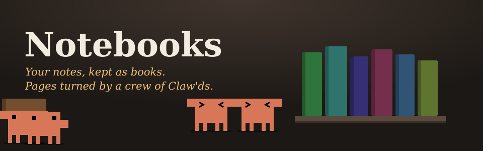
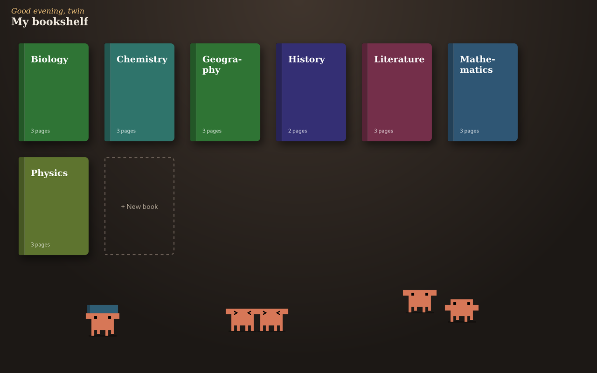
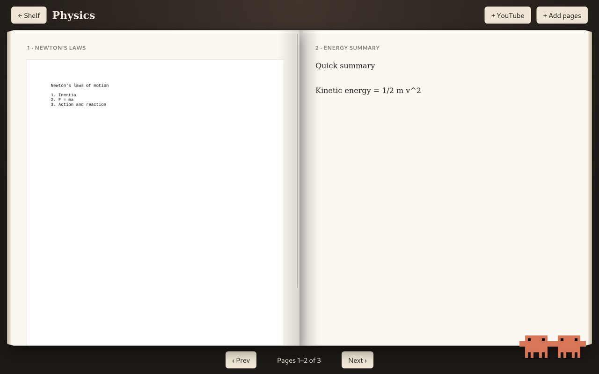
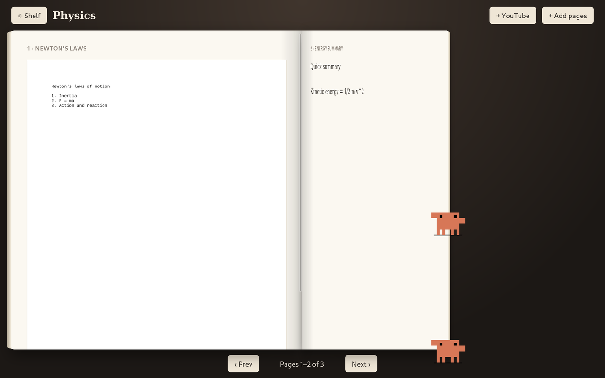
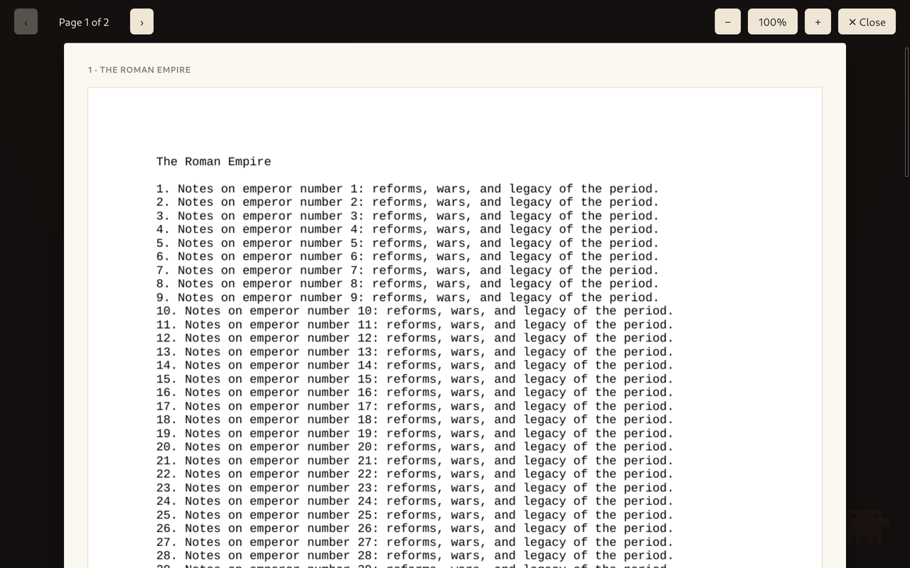
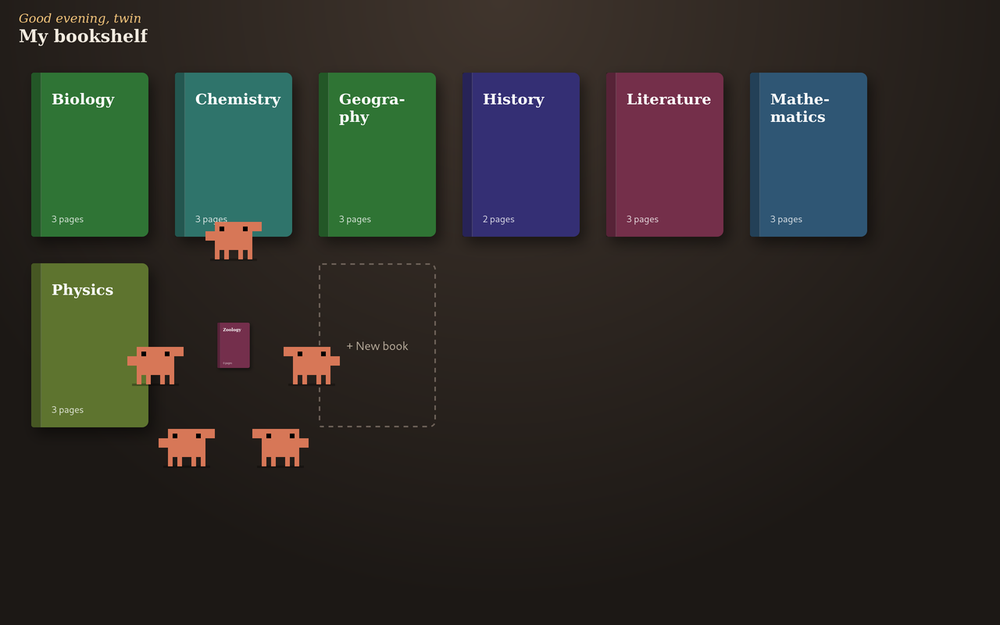

<p align="center">
  
</p>

<p align="center">
  <b>A Linux app that keeps your academic notes as books on a shelf.</b><br>
  Every subject is a book. Every page is one of your documents, as long as that document needs.<br>
  And a little crew of Claw'ds lives on the shelf, turning your pages and building every new book by hand.
</p>

<p align="center">
  
  
  
  
  
</p>

<p align="center">
  
</p>

---

## ✨ What it does

📚 **Books, not folders.** Make a book for each subject (History, Physics, Chemistry…). Each one gets its own colour on the shelf.

📖 **Opens like a real book.** You see a cover first, then two pages side by side, split at the spine. Page 1 is on the left and page 2 on the right.

📄 **One document per page, any length.** A 40-page PDF is one long page you scroll down. A short note is a short page. Nothing gets cut off.

🔍 **Close-up view.** Click any page to see it big, then zoom from 50% to 400%.

🎬 **Videos are pages too.** Drop in a lecture recording and it plays right on the page, with seeking.

▶️ **YouTube import.** Paste a link, pick MP4, M4V, WebM, MKV, MOV or OGV, and it lands in your book as a new page.

🦀 **A crew of Claw'ds.** Five of them roam your shelf, and two of them turn every page for you. [Meet them below.](#-meet-the-crew)

☀️ **It says hi.** "Good morning, twin", "Good noon, twin", "Good afternoon, twin" or "Good evening, twin", depending on the time.

## 📸 A look inside

<table>
  <tr>
    <td width="50%"><p align="center"><b>Two pages, split at the spine</b><br>Each page scrolls on its own.</p></td>
    <td width="50%"><p align="center"><b>Turning a page</b><br>One Claw'd grabs low, one grabs high, and they carry it over together.</p></td>
  </tr>
  <tr>
    <td width="50%"><p align="center"><b>Close-up view</b><br>Zoom in, flip through pages, press Esc to go back.</p></td>
    <td width="50%"><p align="center"><b>Building a new book</b><br>The whole crew gathers round and hammers it together.</p></td>
  </tr>
</table>

## 🦀 Meet the crew

Claw'd is Claude Code's little pixel mascot. Here he comes with friends.

| When… | the Claw'ds… |
|---|---|
| you're on the bookshelf | wander around, stop for a breather, blink now and then |
| two of them bump into each other | walk up face to face, throw their arms up and bounce with happy `>` `<` eyes |
| they're feeling playful | play tag: one runs off, the other chases right behind, three rounds, then they both laugh |
| you make a new book | everyone runs over carrying parts in the book's colour, forms a ring and hammers it together. The book grows with every round, they cheer, and it opens |
| you turn a page | two of them walk to the page corner, grab it (one low, one high), carry it over the spine, lay it down, and smile |
| you **grab one** with the mouse | he dangles from your hand, sways, kicks his legs, flails his arms and squeezes his eyes shut until you let go. Then he lands with a bounce and runs back to what he was doing |

> [!TIP]
> Pages won't turn while you're holding one of the two page-turners. They need both hands free.
> If your system has **reduce motion** turned on, the shelf crew stays out of sight and pages change instantly.

## 🚀 Install

```sh
git clone https://github.com/samiscoolnoway/notebooks.git
cd notebooks
./install.sh
```

Then open **Notebooks** from your app menu (you'll find it under *Education*). That's it.

`install.sh` copies the app to `~/.local/share/notebooks-app` and adds a menu entry. It doesn't need root.

### What it needs

Debian/Ubuntu package names shown. Most desktops already have the first two.

| For | Package | |
|---|---|---|
| the app itself | `python3` | required |
| the app window | `python3-gi`, `gir1.2-webkit2-4.1` | optional: without them it opens in your browser instead |
| PDF pages | `poppler-utils` (`pdftoppm`) | for PDFs |
| Word, PowerPoint, Excel and LibreOffice files | `libreoffice` | for office documents |
| YouTube import | `yt-dlp` (e.g. `pipx install yt-dlp`) and `ffmpeg` | for YouTube |

No `pip install`, no virtualenv: the app only uses Python's standard library.

## 🗂️ Using it

**Adding pages:** open a book and click **+ Add pages**, or just drag files onto the book. Each file becomes the next page.

**Adding a YouTube video:** click **+ YouTube**, paste the link and choose a format. MP4 is the safest choice. OGV has to re-encode the whole video, so it's slow. If the video is part of a playlist, only that one video is saved.

### What can go on a page

| Kind | File types | Shown as |
|---|---|---|
| Documents | `.pdf` | every PDF page as an image, top to bottom |
| Office files | `.doc` `.docx` `.odt` `.rtf` `.ppt` `.pptx` `.odp` `.xls` `.xlsx` `.ods` | converted with LibreOffice, then shown like a PDF |
| Images | `.png` `.jpg` `.jpeg` `.gif` `.webp` `.svg` `.bmp` | the image |
| Videos | `.mp4` `.m4v` `.webm` `.mkv` `.mov` `.ogv` | a video player you can seek in |
| Text | `.txt`, `.md`, anything else that's plain text | the text |

Anything else is still saved in the book; it just can't be previewed.

### Keyboard

| Where | Key | Does |
|---|---|---|
| Open book | <kbd>→</kbd> / <kbd>←</kbd> | next / previous pages |
| Open book | <kbd>Esc</kbd> | back to the shelf |
| Close-up | <kbd>→</kbd> / <kbd>←</kbd> | next / previous page |
| Close-up | <kbd>+</kbd> / <kbd>−</kbd>, or <kbd>Ctrl</kbd> + scroll | zoom in / out |
| Close-up | <kbd>Esc</kbd> | close |

## 💾 Where your notes live

Plain folders, nothing hidden away in a database:

```
~/Notebooks/
├── History/
│   ├── 001 The Roman Empire.pdf
│   └── 002 Lecture recording.mp4
└── Physics/
    ├── 001 Newton's laws.docx
    └── 002 Energy summary.txt
```

Each book is a folder and each page is a file. The number at the front sets the page order, so you can rename, reorder, copy or back up your books with any file manager. Rendered page images are cached in a hidden `.pages` folder inside each book and rebuilt whenever the file changes.

## 🔒 Private by design

The app runs a tiny web server that only listens on `127.0.0.1` (your own computer) and shows it in its own window. Nothing is uploaded anywhere. The only time it goes online is when you ask it to download a YouTube video.

It checks every request, so websites you visit can't read or change your books, and no file path can reach outside your Notebooks folder.

## 🛠️ For tinkerers

```sh
python3 app.py            # run without installing
python3 app.py --serve    # just the server; open the printed address in a browser
python3 test_app.py       # self-check (uses a temporary folder, never touches ~/Notebooks)
```

| Setting | Default | |
|---|---|---|
| `NOTEBOOKS_DIR` | `~/Notebooks` | where books are stored |
| `NOTEBOOKS_PORT` | a free port | the port the local server uses |

| File | What's in it |
|---|---|
| `app.py` | the local server: books, uploads, PDF/office rendering, video streaming, YouTube import, and the GTK window |
| `index.html` | everything you see: the shelf, the open book, the close-up view, and the Claw'd crew |
| `install.sh` | copies the app into place and adds the menu entry |
| `test_app.py` | end-to-end checks against a throwaway library |

---

<p align="center">
  Built with <a href="https://claude.com/claude-code">Claude Code</a>. Claw'd is Claude Code's mascot, redrawn here in pixels.<br>
  <sub>No Claw'ds were harmed in the making of this app. A few were picked up and squirmed a bit.</sub>
</p>
